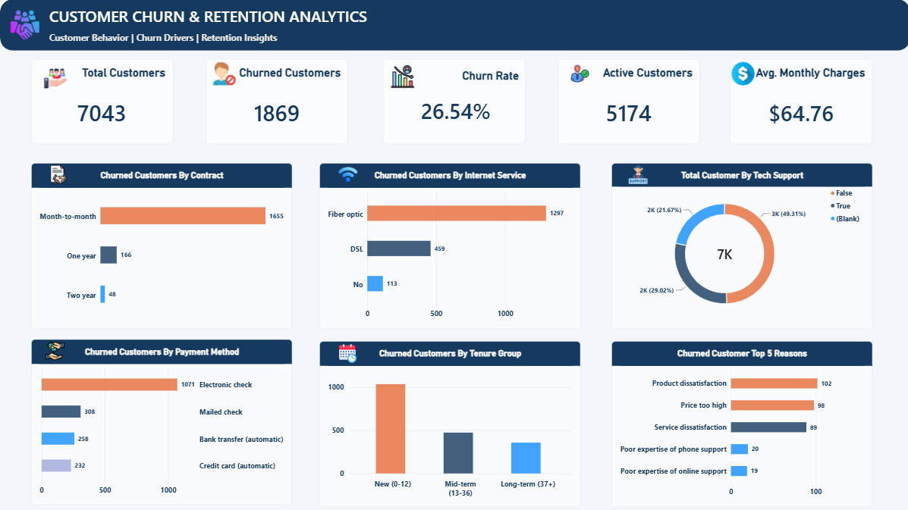

# Customer Churn & Retention Analytics

## Project Overview
Analyzed telecom customer data to identify churn patterns,
high-risk customer segments, and retention opportunities.

## Tools & Technologies
- Python (Pandas)
- SQL Server
- Power BI
- DAX

## Key KPIs
- Total Customers: 7,043
- Churned Customers: 1,869
- Active Customers: 5,174
- Churn Rate: 26.54%
- Average Monthly Charges: $64.76

## Analysis
- Churn by Contract Type
- Churn by Payment Method
- Churn by Internet Service
- Churn by Tenure Group
- Top 5 Customer Churn Reasons

## Dashboard Preview

## Files
- `data_check.py` — Python data analysis
- `Churn.sql` — SQL analysis queries
- `Churn Customer Analysis.pbix` — Power BI dashboard
- `telco_churn_cleaned.csv` — Cleaned dataset
- `Churn_Customer.png` — Dashboard screenshot
